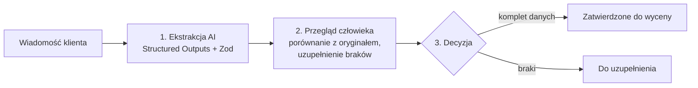

# RFQ Quote Prep

> Narzędzie, które zamienia chaotyczne maile z zapytaniami ofertowymi (RFQ) w uporządkowane dane gotowe do wyceny. AI proponuje, człowiek weryfikuje i zatwierdza.
>
> *English: an internal-tool style app that turns unstructured RFQ emails into structured quote data — AI extracts, a human reviews and approves.*

**Demo:** `https://TWOJ-ADRES.vercel.app` · **Kod:** to repozytorium


## Problem

Firmy handlowe i produkcyjne dostają zapytania ofertowe jako zwykły tekst: ilości, terminy i parametry są rozrzucone po mailu, a wycena zaczyna się od ręcznego przepisywania. To wolne i podatne na pomyłki (np. numer modelu wzięty za ilość).

## Jak to działa



1. **Ekstrakcja AI** — model odczytuje pozycje (produkt, ilość, specyfikacja), termin i miejsce dostawy. Czego nie jest pewien, zostawia jako `null`, zamiast zgadywać.
2. **Przegląd człowieka** — użytkownik widzi oryginalną wiadomość obok wyniku, poprawia pola i zapisuje szkic. Aplikacja na bieżąco liczy brakujące pola.
3. **Decyzja** — zatwierdzenie jest możliwe dopiero, gdy wymagane pola są uzupełnione. Walidację powtarza serwer, więc nie da się jej ominąć z przeglądarki.

| Status | Znaczenie |
| --- | --- |
| `RECEIVED` | Zapytanie dodane, jeszcze bez ekstrakcji |
| `EXTRACTED` | Dane wyodrębnione, czekają na przegląd |
| `NEEDS_INFO` | Oznaczone do uzupełnienia u klienta |
| `APPROVED` | Zatwierdzone przez człowieka do wyceny |


## Decyzje projektowe

- **Człowiek w pętli.** Zgodność ze schematem nie oznacza poprawności treści, dlatego AI nigdy sam niczego nie zatwierdza.
- **Jeden schemat, dwa zastosowania.** Zod definiuje strukturę odpowiedzi dla modelu i ponownie waliduje wynik po stronie serwera.
- **Osobne dane AI i człowieka.** `extractionData` (wynik modelu) i `reviewData` (wersja po poprawkach) są osobnymi polami, więc ponowna ekstrakcja nie nadpisuje pracy użytkownika.
- **Ostrożne wartości domyślne.** Niejednoznaczna ilość zostaje pusta i trafia do przeglądu, zamiast trafić do wyceny jako pewna.
- **Dostępność.** Pełna obsługa klawiaturą, stany błędów powiązane z polami (`aria-describedby`), komunikaty `role="status"`/`role="alert"`, wsparcie `prefers-reduced-motion`.

## Stack

Next.js (App Router) · React · TypeScript · Tailwind CSS · Prisma · PostgreSQL (Neon) · Zod · OpenAI Responses API (Structured Outputs)

## Uruchomienie lokalne

```bash
npm install            # uruchamia też prisma generate
cp .env.example .env   # uzupełnij wartości
npx prisma migrate deploy
npm run dev
```

Zmienne środowiskowe (nigdy nie commituj prawdziwych wartości):

| Zmienna | Opis |
| --- | --- |
| `DATABASE_URL` | Połączenie z Neon przez pooler (do działania aplikacji) |
| `DIRECT_URL` | Połączenie bezpośrednie z Neon (do migracji Prisma) |
| `OPENAI_API_KEY` | Klucz OpenAI, używany tylko po stronie serwera |

## Wdrożenie

Instrukcja krok po kroku (Vercel + Neon): [`docs/DEPLOY.md`](docs/DEPLOY.md).

## Ograniczenia i dalsze kroki

To projekt demonstracyjny, więc świadomie nie ma jeszcze:

- logowania i podziału na użytkowników lub zespoły,
- limitu zapytań (rate limiting) na endpointach,
- eksportu zatwierdzonych danych (CSV / integracja z systemem wycen),
- zestawu testów dokładności ekstrakcji na większej próbce prawdziwych zapytań.

Pełny opis architektury i endpointów: [`docs/ARCHITECTURE.md`](docs/ARCHITECTURE.md). Pierwotny plan koncepcyjny: [`docs/RFQ_QUOTE_PREP_BLUEPRINT.md`](docs/RFQ_QUOTE_PREP_BLUEPRINT.md).

## Autor

Maksymilian Bąk · [LinkedIn](https://www.linkedin.com/in/maksymilianbak)
